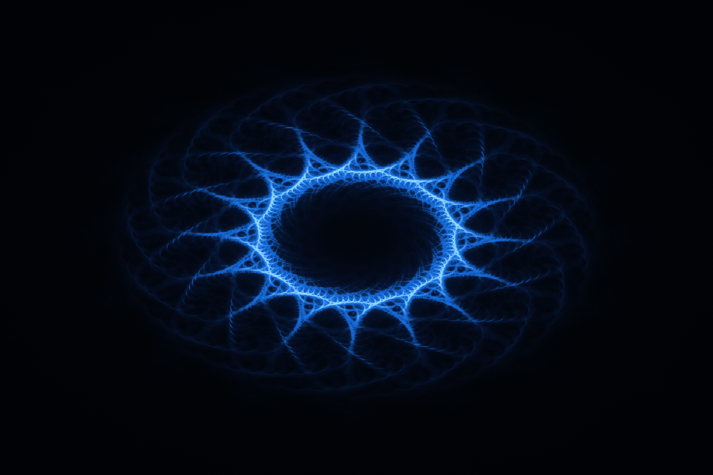

# Möbius Complex Dynamics Laboratory

An interactive real-time mathematical artwork and generative dynamics laboratory running directly in WebGL2.



## Core Mathematics

The artwork emerges iteratively from repeated complex-number Möbius transformations:

$$f(z) = \frac{az + b}{cz + d}$$

combined with rotational copies using roots of unity:

$$\omega_k = e^{2\pi i k / n}, \quad k \in \{0, 1, \dots, n-1\}$$

Trajectories are generated on the GPU using WebGL2 Transform Feedback and accumulated into a 32-bit floating-point accumulation buffer (`RGBA32F` with `RGBA16F` fallback). Visual luminance emerges naturally from trajectory recurrence density.

## Key Features

- **GPU Simulation Engine:** Transform Feedback pipeline processing up to 1.2M+ trajectory deposits per frame.
- **Drift-Aware Persistence Architecture:**
  - **Stationary Idle:** $p = 0.99925$ for deep photographic accumulation and microscopic filament resolution.
  - **Autonomous Drift:** $p = 0.9985$ to maintain stark negative-space contrast and prevent motion haze.
  - **Active Interaction:** $p = 0.97$ to prevent blackout dimming while clearing drag trails smoothly within 1–2 seconds.
- **Adaptive Performance:** Dynamic tiering (Standard: 150k particles $\times$ 8 steps) targeting stable 60 FPS across varied hardware.
- **Multi-Scale Deep Zoom:** Smooth continuous zoom from macroscopic organism to hairline caustics and nested orbital loops.
- **Live Equation Readout:** Real-time parameter display tracking complex coefficients $a, b, c, d$ and rotational order $n$.

## Interactive Controls

| Action | Control |
| :--- | :--- |
| **Hover over the artwork** (Explore) | Bend the complex coefficients in real time |
| **Click** (Explore) | Inject a topological shock with smooth relaxation |
| **Shift-drag / right-drag** (Explore) | Pan |
| **Mouse wheel** (Explore) | Continuous deep multi-scale zoom (framing is locked in Reference) |
| **1 / 2 / 3** | Reference / Explore / Randomize |
| **Space** | Pause / resume autonomous coefficient drift (Explore) |
| **R** | Reset view |
| **P** | Coefficient sliders (opens the Controls panel) |
| **B / O** | Toggle bloom / equation readout |
| **E / S** | Export / Presets |
| **H** | Hide / show the controls |
| **?** | Controls & shortcuts help |
| **Esc** | Close a dialog, menu or the Controls panel |
| **T / D / X** | Developer: raw trajectories / debug overlay / Brute Force live quality on-off |

Everything else (palette, zoom buttons, order *n*, live-preview quality, display options) lives in the **Controls** panel. Touch pinch/pan gestures are not implemented.

## Local Development

Run any static HTTP server in the project directory:

```bash
# Python 3
python -m http.server 8000

# Node.js
npx serve .
```

Open `http://localhost:8000` in any modern browser supporting WebGL2.

## Repository layout

The root holds the application: `index.html` and the ES modules it loads (`app.js`, `renderer.js`, `math.js`, `adaptive.js`, `profiler.js`, `preset_validation.js`). Everything else is engineering material in folders:

| Folder | Contents |
| :--- | :--- |
| [`docs/`](docs/README.md) | [Release-candidate report](docs/RELEASE_CANDIDATE_REPORT.md), [hardening report](docs/HARDENING_REPORT.md), [UI/UX audit](docs/ui/UI_UX_AUDIT.md), archived issue reports and experiments |
| [`tests/`](tests/README.md) | the regression and hardening suite (`python tests/run_all.py`) |
| [`benchmarks/`](benchmarks/README.md) | performance and quality measurement tooling |
| [`scripts/`](scripts/README.md) | verification, capture and probing utilities |
| [`release_checks/`](release_checks/README.md) | real-browser checks run against the deployed site |
